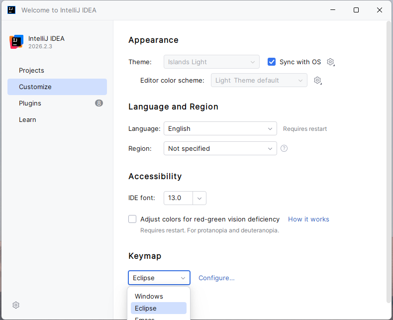
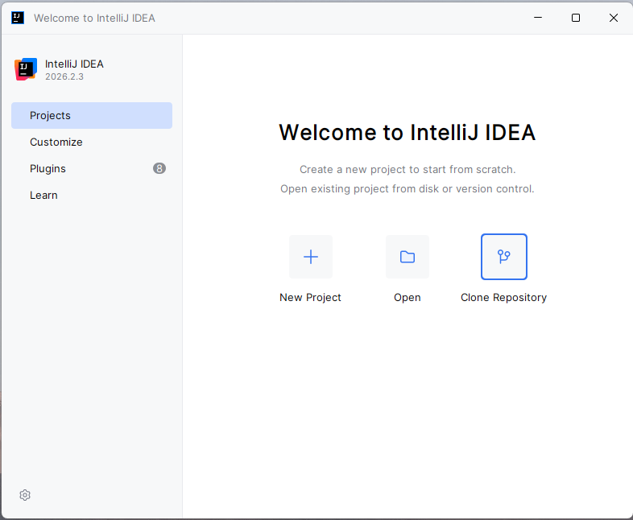
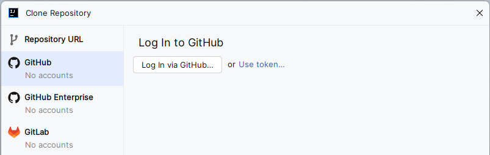
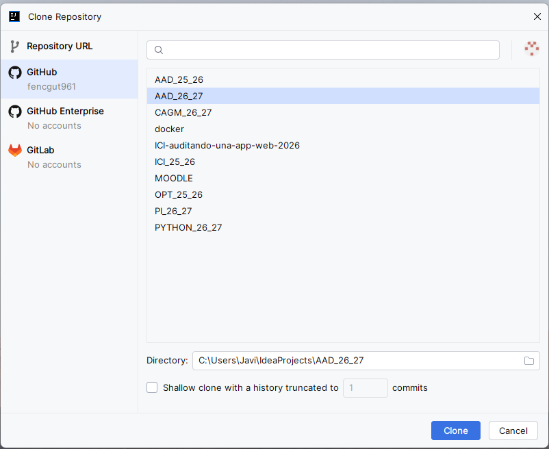
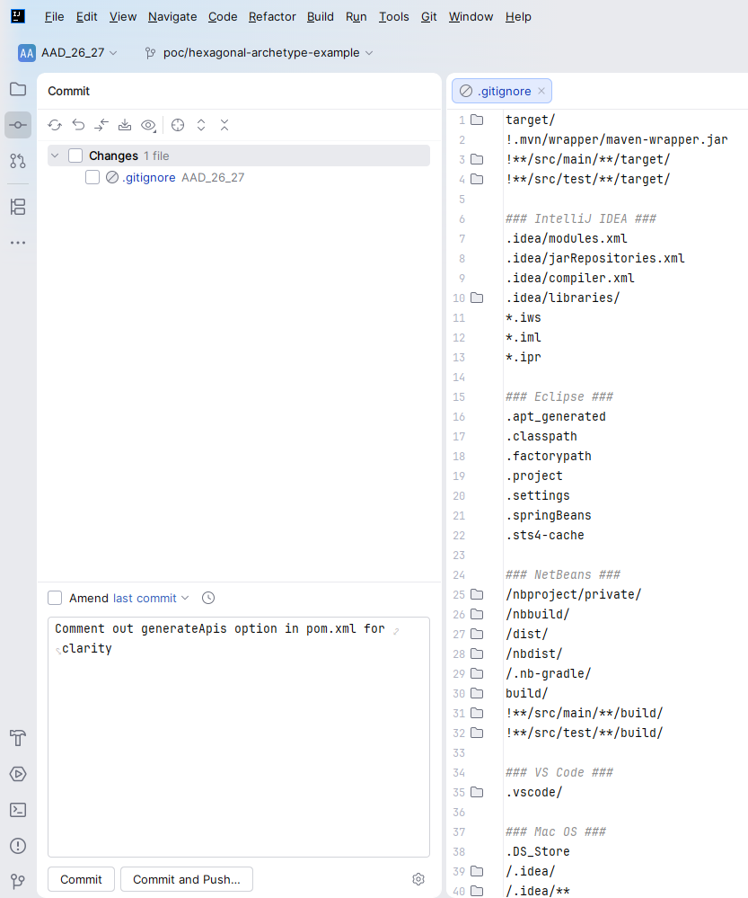

# RA0: Onboarding y Configuración del Entorno de Desarrollo

Este documento sirve como guía oficial de referencia rápida para configurar el entorno de trabajo homogéneo que utilizaremos durante todo el curso en el módulo de **Acceso a Datos**. El objetivo de esta unidad es dejar listos tu IDE, tu sistema de control de versiones, tu primera aplicación Spring Boot y una base de datos local contenerizada.

---

## Índice
1. [Configuración de IntelliJ IDEA Community (Portable)](#1-configuración-de-intellij)
2. [Control de Versiones con GitHub](#2-control-de-versiones-con-github)
3. [Creación del Proyecto Base en Spring Boot](#3-creación-del-proyecto-base-en-spring-boot)
4. [Simplificación de Código con Lombok](#4-simplificación-de-código-con-lombok)
5. [Contenedores de Base de Datos con Docker Desktop y PostgreSQL](#5-contenedores-de-base-de-datos-con-docker-desktop-y-postgresql)
6. [Gestión de la Base de Datos con DBeaver Portable](#6-gestión-de-la-base-de-datos-con-dbeaver-portable)

---

## 1. Configuración de IntelliJ IDEA Community (Portable)

**Objetivo:** Disponer de un Entorno de Desarrollo Integrado (IDE) funcional, potente y portátil para programar en Java y Spring Boot sin necesidad de permisos de administrador.

### 1.1 Descargar IntelliJ Community Portable
1. Entra en el sitio web de Portapps: [Portapps - IntelliJ IDEA Community Portable](https://portapps.io/app/intellij/).
2. Descarga la versión **Portable (ZIP)** correspondiente a la arquitectura de tu sistema (generalmente Windows 64-bits).


### 1.2 Descompresión y Estructura de Directorios
Para mantener todo organizado de forma portátil en tu equipo o unidad USB, sigue esta estructura estricta de carpetas:

1. Crea o descomprime la aplicación en un directorio raíz limpio, evitando espacios en la ruta. Por ejemplo:
   `C:\aad\intellij\`
2. Crea una carpeta dedicada para tu área de trabajo (workspace) donde se guardarán todos los proyectos de clase:
   `C:\aad\intellij\workspace\`
3. Crea una carpeta para centralizar los JDKs (Kits de Desarrollo de Java) que vayas a descargar:
   `C:\aad\intellij\jdks\`

### 1.3 Primer Inicio y Configuración de IntelliJ
Una vez ejecutado el IDE por primera vez, realiza las siguientes configuraciones iniciales:

* **Keymap de Eclipse:** Si vienes de utilizar Eclipse en cursos anteriores y estás acostumbrado a sus atajos, puedes mantenerlos yendo a:
  `Customize` -> `Keymap` -> Seleccionar **Eclipse** en el menú desplegable.


---

## 2. Control de Versiones con GitHub

**Objetivo:** Configurar tu portafolio de código en la nube, aprender a versionar tus proyectos y enlazar tu IDE IntelliJ para automatizar tus commits de forma segura.

### 2.1 Crear una Cuenta en GitHub
1. Si no dispones de una, entra en [GitHub](https://github.com/) y haz clic en **Sign Up**.
2. Sigue los pasos introduciendo un nombre de usuario profesional, tu correo electrónico y una contraseña segura.
3. No olvides verificar tu correo electrónico abriendo el enlace de confirmación que te llegará a la bandeja de entrada.

### 2.2 Crear el Repositorio de la Asignatura
1. En tu página de inicio de GitHub, haz clic en el botón **New** para crear un nuevo repositorio.
2. Configura los datos del repositorio:
   * **Repository name:** `acceso-a-datos` o el nombre sugerido para el curso actual (ej. `AAD_[CURSO_ACTUAL]`).
   * **Description:** Repositorio de prácticas y proyectos del módulo de Acceso a Datos.
   * **Public/Private:** Según las indicaciones del docente.
3. Haz clic en **Create repository**.

### 2.3 Clonación y Configuración Inicial Local
Para trabajar sobre este repositorio remoto, debes traerlo a tu entorno de desarrollo local:

1. Para ello en la pantalla de Intellij inicial ubica en `Projects` la opción `Clone Repository`. 
2. En la pantalla Clone Repository, selecciona **Github** y logea en tu cuenta. 
3. Una vez logeado en tu cuenta selecciona el repositorio que quieres clonar dentro de tu workspace:
   `C:\aad\intellij\workspace\AAD_26_27` y dale a **Clone** 

   
4. **Ignorar Archivos Locales (.gitignore):**
   Los entornos de desarrollo generan archivos de configuración que no deben subirse a la nube porque dependen de la máquina de cada programador.
   * Abre o crea un archivo llamado `.gitignore` en la raíz de tu proyecto. Si creaste el proyecto con [Spring Initializr](https://start.spring.io/) ya deberías tener el fichero una vez descomprimas e importes el proyecto al repositorio clonado.
   * Dentro de este fichero deberás incluir una líea por cada carpeta o fichero que quieras ignorar, evitando que se suban los metadatos específicos de tu IntelliJ o de terceros:
     ```
     ### IntelliJ IDEA ###
     .idea
     ```
5. Haz tu primer **Commit & Push** para validar el funcionamiento:
   * En la parte izquiera de IntelliJ, selecciona la opción `Commit`.
   
   * Añade un mensaje descriptivo: `chore: add gitignore rules for IntelliJ`.
   * Pulsa **Commit and Push** para enviar los cambios a GitHub y comprueba en el navegador que el archivo se ha subido correctamente.

---

## 3. Creación del Proyecto Base en Spring Boot

**Objetivo:** Generar la estructura limpia de nuestro microservicio Java utilizando Spring Initializr, integrarlo en nuestro repositorio local y personalizar el inicio del sistema.

### 3.1 Configuración en Spring Initializr
Entra en [Spring Initializr](https://start.spring.io/) y define la estructura técnica del proyecto de la asignatura utilizando los siguientes metadatos:

* **Project:** Maven
* **Language:** Java
* **Spring Boot:** 4.1.1 (o la versión de producción estable más reciente)
* **Project Metadata:**
  * **Group:** `com.fencgut961` (Dominio del proyecto inverso)
  * **Artifact:** `aad` (Identificador del proyecto de Acceso a Datos)
  * **Name:** `aad` (Nombre del servicio)
  * **Description:** Proyecto base para el módulo de Acceso a Datos
  * **Package name:** `com.fencgut961.aad`
  * **Packaging:** Jar
  * **Configuration:** YAML
  * **Java:** 21 (asegúrate de que coincida con el JDK descargado en tu IntelliJ portable)
* **Dependencies:**
  * Haz clic en **Add Dependencies** y añade:
    * **Spring Web** (necesaria para habilitar los componentes REST de la aplicación).
    * **Lombok** (la usaremos para el punto 4)


### 3.2 Generación e Integración
1. Haz clic en el botón **Generate** (o pulsa `Ctrl + Enter`) para descargar el archivo ZIP autogenerado.
2. Descomprime el contenido de este archivo ZIP directamente dentro de tu carpeta del repositorio de GitHub local que clonaste en el paso anterior (`C:\aad\intellij\workspace\AAD_26_27`).
3. Abre el proyecto en IntelliJ. El IDE detectará automáticamente que es un proyecto Maven e importará todas las dependencias del archivo `pom.xml`.
4. **Limpieza de archivos residuales:** Puedes borrar de la raíz del proyecto los archivos CLI de Maven que no vayamos a utilizar directamente, como la carpeta `.mvn/`, el script `mvnw` y `mvnw.cmd`.
5. **Descargar y Configurar el SDK (JDK):**
   1. Ve a `File` -> `Project Structure` -> `SDKs`.
   2. Haz clic en el botón `+` (Add SDK) -> `Download JDK`.
   3. Selecciona la versión **Java 21** (o la versión recomendada para el curso) y la distribución (ej. Eclipse Temurin o Oracle OpenJDK).
   4. **Importante:** Establece la ruta de descarga dentro de la carpeta portable que creaste en el paso anterior:
     `C:\aad\intellij\jdks\`
6. **Acciones al Guardar (Actions on Save):**
  Automatiza el formateo de tu código para mantenerlo limpio. Ve a `Settings` -> `Tools` -> `Actions on Save` y marca las casillas:
   * [x] *Reformat code*
   * [x] *Optimize imports*

7. **Algunos Plugins**
Instala los siguientes plugins desde el Marketplace de IntelliJ (`Settings` -> `Plugins`):
1. **Lombok:** Vital para evitar escribir código repetitivo (boilers) en Java.
2. **SonarQube:** Analiza el código mientras programas y detecta posibles errores, problemas de calidad, vulnerabilidades y malas prácticas. Ayuda a mejorar la legibilidad, la seguridad y el mantenimiento del código Java.
3. **Grep Console:** Añade colores personalizados a la consola de salida de IntelliJ para distinguir fácilmente entre logs de tipo `INFO`, `WARN` y `ERROR`.


### 3.3 Personalización: Creación de un Banner Propio
Por defecto, al iniciar una aplicación de Spring Boot se muestra un logotipo en modo texto ASCII de "Spring". Vamos a cambiarlo para que muestre el identificador de nuestro módulo:

1. Accede al generador gratuito de banners ASCII: [Spring Boot Banner Generator](https://devops.datenkollektiv.de/banner.txt/index.html).
2. Escribe el texto que desees, por ejemplo: **`AAD`** o **`ACCESO A DATOS`**, y selecciona un formato de tipografía que te guste.
3. Copia el texto ASCII resultante.
4. En tu proyecto de IntelliJ, navega hasta la carpeta de recursos de la aplicación:
   `src/main/resources/`
5. Crea un nuevo archivo de texto plano en esa carpeta llamado exactamente **`banner.txt`** y pega el texto ASCII dentro de él.
6. Arranca la aplicación ejecutando la clase principal `AadApplication.java`. Verás cómo en tu terminal de IntelliJ ahora aparece tu banner personalizado en lugar del logotipo genérico de Spring.

### 3.4 Implementación del CommandLineRunner
Para evitar que nuestra aplicación de Spring Web se cierre inmediatamente y para poder simular un flujo secuencial clásico (como el método `main` clásico de Java SE) de forma limpia, implementaremos la interfaz `CommandLineRunner`:

1. Abre el archivo principal `AadApplication.java`.
2. Modifica la clase para implementar `CommandLineRunner` y sobreescribe su método `run`, de la siguiente forma:

```java
package com.fencgut961.aad;

import org.springframework.boot.CommandLineRunner;
import org.springframework.boot.SpringApplication;
import org.springframework.boot.autoconfigure.SpringBootApplication;

@SpringBootApplication
public class AadApplication implements CommandLineRunner {

    public static void main(String[] args) {
        SpringApplication.run(AadApplication.class, args);
    }

    @Override
    public void run(String... args) throws Exception {
        System.out.println("--- Aplicación Base de Acceso a Datos Iniciada Correctamente ---");
    }
}
```

3. Guarda los cambios, realiza un **Commit** con el mensaje `feat: implement base project with custom banner and CommandLineRunner` y haz **Push** para sincronizarlo con tu repositorio de GitHub.

---

## 4. Simplificación de Código con Lombok

**Objetivo:** Utilizar la librería Project Lombok para reducir la necesidad de escribir manualmente código repetitivo (como constructores, getters, setters, métodos toString o declaradores de Loggers).

### 4.1 Instalación del Plugin de Lombok en IntelliJ
Asegúrate de que el plugin de Lombok está instalado y activo en tu entorno de desarrollo portátil (suele venir preinstalado en las versiones recientes de IntelliJ):
1. Ve a `Settings` -> `Plugins`.
2. Busca **Lombok** y verifica que está habilitado.
3. **Paso crítico obligatorio:** Debes habilitar el procesamiento de anotaciones en tu compilador. Para ello, ve a:
   `Settings` -> `Build, Execution, Deployment` -> `Compiler` -> `Annotation Processors`
   * Activa la casilla: **[x] Enable annotation processing**.

### 4.2 Añadir la Dependencia en el POM (si no se selecciono al crear el proyecto)
Para que Maven sepa que debe inyectar Lombok durante la fase de compilación, abre tu archivo `pom.xml` y añade la siguiente dependencia dentro de la sección `<dependencies>`:

```xml
<dependency>
    <groupId>org.projectlombok</groupId>
    <artifactId>lombok</artifactId>
    <optional>true</optional>
</dependency>
```

### 4.3 Verificación de Lombok con Logging Estructurado
Sustituiremos la salida clásica `System.out.println` por un sistema de logs real y profesional haciendo uso de la anotación `@Slf4j` de Lombok:

1. Modifica la clase `AadApplication.java` utilizando las anotaciones de Lombok:

```java
package com.fencgut961.aad;

import lombok.extern.slf4j.Slf4j;
import org.springframework.boot.CommandLineRunner;
import org.springframework.boot.SpringApplication;
import org.springframework.boot.autoconfigure.SpringBootApplication;

@SpringBootApplication
@Slf4j // Esta anotación genera automáticamente el campo de log 'log' usando la librería SLF4J
public class AadApplication implements CommandLineRunner {

    public static void main(String[] args) {
        SpringApplication.run(AadApplication.class, args);
    }

    @Override
    public void run(String... args) throws Exception {
        log.info("=== [LOMBOK STATUS]: Lombok ON ===");
    }
}
```

2. Ejecuta la aplicación de nuevo. Verifica en la consola que el mensaje aparece con un formato estructurado de log (`INFO` junto con la fecha, hora, hilo de ejecución y nombre de la clase).
3. Haz **Commit & Push** a tu repositorio de GitHub con el mensaje `feat: integrate lombok dependency and test slf4j logger`.

---

## 5. Contenedores de Base de Datos con Docker Desktop y PostgreSQL

**Objetivo:** Desplegar una base de datos relacional PostgreSQL de producción en cuestión de segundos utilizando Docker Compose, garantizando que todos los alumnos utilicen exactamente el mismo motor y configuración.

### 5.1 Instalar Docker Desktop
1. Descarga el instalador de Docker Desktop para tu sistema operativo desde: [Docker Desktop](https://www.docker.com/products/docker-desktop/).
2. Sigue los pasos del asistente de instalación manteniendo las opciones por defecto y reinicia tu equipo cuando la instalación lo solicite.
3. **Solución de problemas comunes:** Si Docker muestra un error relacionado con la virtualización al iniciar, deberás acceder a la BIOS/UEFI de tu ordenador al arrancar y habilitar la opción de **Tecnología de Virtualización (VT-x / AMD-V)**.

### 5.2 Comprobar el Funcionamiento de Docker
Abre una terminal o consola de comandos y ejecuta:
```bash
# Verifica que Docker está instalado y responde correctamente
docker --version

# Ejecuta un contenedor de prueba para certificar la conexión con los servidores de imágenes
docker run hello-world
```

### 5.3 Crear el Fichero de Orquestación Docker Compose
En lugar de lanzar comandos largos por consola, utilizaremos un archivo declarativo de Docker Compose para definir nuestra base de datos PostgreSQL de forma reproducible:

1. Crea una carpeta llamada `docker/` en la raíz de tu proyecto o repositorio.
2. Dentro de esa carpeta, crea un archivo de texto plano llamado exactamente **`docker-compose.yml`**.
3. Añade la configuración que define el contenedor de PostgreSQL, su puerto, credenciales de acceso y un volumen físico persistente para no perder los datos al apagar el contenedor:

```yaml
services:
  database:
    image: postgres:15-alpine
    container_name: postgres
    restart: always
    environment:
      POSTGRES_USER: postgres_user
      POSTGRES_PASSWORD: postgres_pass
      POSTGRES_DB: aad
    ports:
      - "5432:5432"
    volumes:
      - postgres_data:/var/lib/postgresql/data

volumes:
  postgres_data:
    driver: local
```

### 5.4 Levantar e Interrumpir el Contenedor de Base de Datos
Para gestionar el ciclo de vida de tu base de datos contenerizada, ejecuta los siguientes comandos desde una terminal situada dentro de la carpeta `docker/` donde se encuentra tu archivo `docker-compose.yml`:

* **Levantar la Base de Datos:**
  ```bash
  # Levanta el contenedor en primer plano para ver los logs de arranque
  docker compose up
  
  # Opcional (Recomendado): Levantar en segundo plano (detached mode) para liberar la terminal
  docker compose up -d
  ```
  *Puedes comprobar que está corriendo abriendo la interfaz gráfica de Docker Desktop o ejecutando `docker ps` en tu consola.*

* **Detener el Contenedor (sin perder datos):**
  ```bash
  docker compose down
  ```

---

## 6. Configuración de DBeaver Portable y Conexión SQL

**Objetivo:** Disponer de un cliente universal de bases de datos de tipo portable para explorar tablas, realizar consultas SQL de prueba e interactuar de forma gráfica con nuestra base de datos PostgreSQL contenerizada.

### 6.1 Descargar DBeaver Portable
1. Accede a la sección de descargas portables de Portapps: [Portapps - DBeaver Portable](https://portapps.io/app/dbeaver-portable/).
2. Descarga el paquete comprimido ZIP y extráelo en tu directorio portátil del curso. Por ejemplo:
   `C:\apuntes-aad\dbeaver-portable\`
3. Abre la aplicación ejecutando el archivo ejecutable de DBeaver.

### 6.2 Crear Conexión con PostgreSQL
1. En DBeaver, ve al menú superior: **Database** -> **New Database Connection**.
2. Selecciona **PostgreSQL** de la lista de conectores disponibles y haz clic en *Next*.
3. Completa los campos del formulario con los parámetros que declaraste en tu archivo `docker-compose.yml`:
   * **Host:** `localhost`
   * **Port:** `5432`
   * **Database:** `aad`
   * **Username:** `postgres_user`
   * **Password:** `postgres_pass`
4. Haz clic en el botón **Test Connection**. 
   * *Nota: La primera vez que lo hagas, DBeaver te solicitará permiso para descargar automáticamente los drivers JDBC necesarios para conectarse a PostgreSQL. Haz clic en "Download" e instálalos.*
5. Si todo está correcto y el contenedor de Docker sigue activo, se mostrará un mensaje de conexión exitosa (**Success**). Haz clic en *Finish* para guardar el perfil de conexión.

### 6.3 Crear y Probar una Tabla de Validación SQL
Para certificar que la base de datos está plenamente operativa y que la persistencia funciona, realiza los siguientes pasos:

1. En el panel izquierdo de DBeaver, haz clic derecho sobre tu nueva conexión de PostgreSQL y selecciona **SQL Editor** -> **Open SQL console**.
2. Escribe y ejecuta el siguiente script DDL/DML de prueba en el editor:

```sql
-- 1. Crear una tabla de prueba de alumnos
CREATE TABLE prueba (
    id SERIAL PRIMARY KEY,
    nombre VARCHAR(50) NOT NULL,
    creado_en TIMESTAMP DEFAULT CURRENT_TIMESTAMP
);

-- 2. Insertar registros iniciales de validación
INSERT INTO prueba (nombre) VALUES ('Alumno Acceso a Datos');
INSERT INTO prueba (nombre) VALUES ('Profesor Onboarding');

-- 3. Consultar y verificar los datos
SELECT * FROM prueba;
```

3. Selecciona todo el código SQL y presiona el botón naranja de ejecución (o presiona `Ctrl + Enter` en cada sentencia).
4. Verifica que el panel inferior muestra el listado con los dos alumnos insertados correctamente junto con su identificador autoincremental y fecha de registro.

---

¡Felicidades! Siguiendo todos los pasos de esta guía técnica interactiva, has configurado con éxito un entorno de desarrollo profesional, portable, aislado, reproducible y versionado bajo GitHub, listo para afrontar todas las prácticas del módulo de **Acceso a Datos**.
