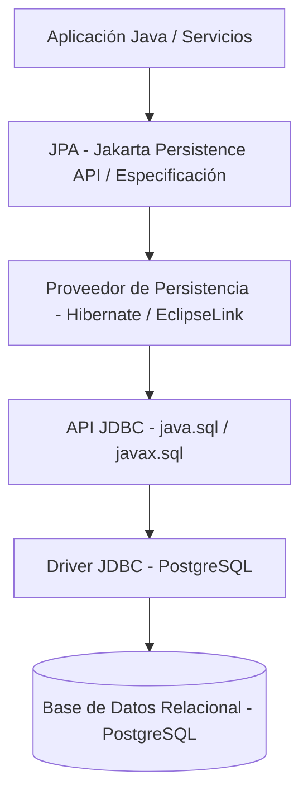
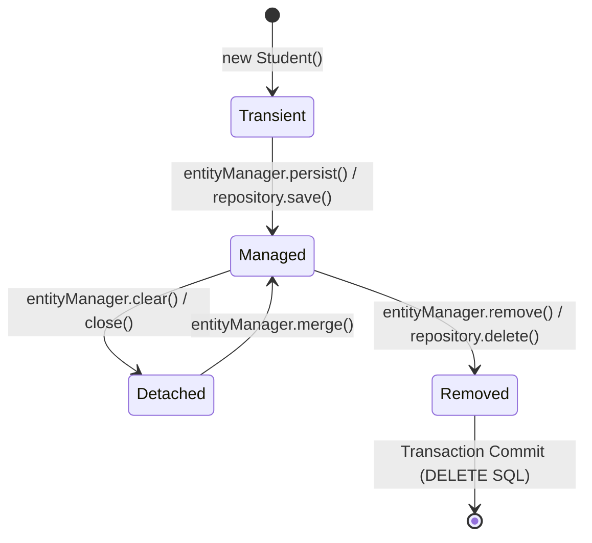
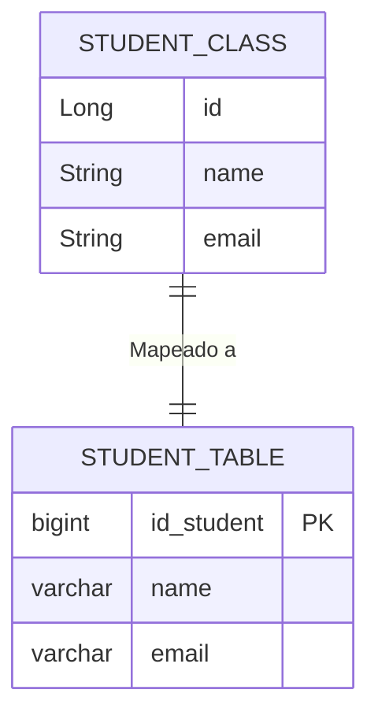
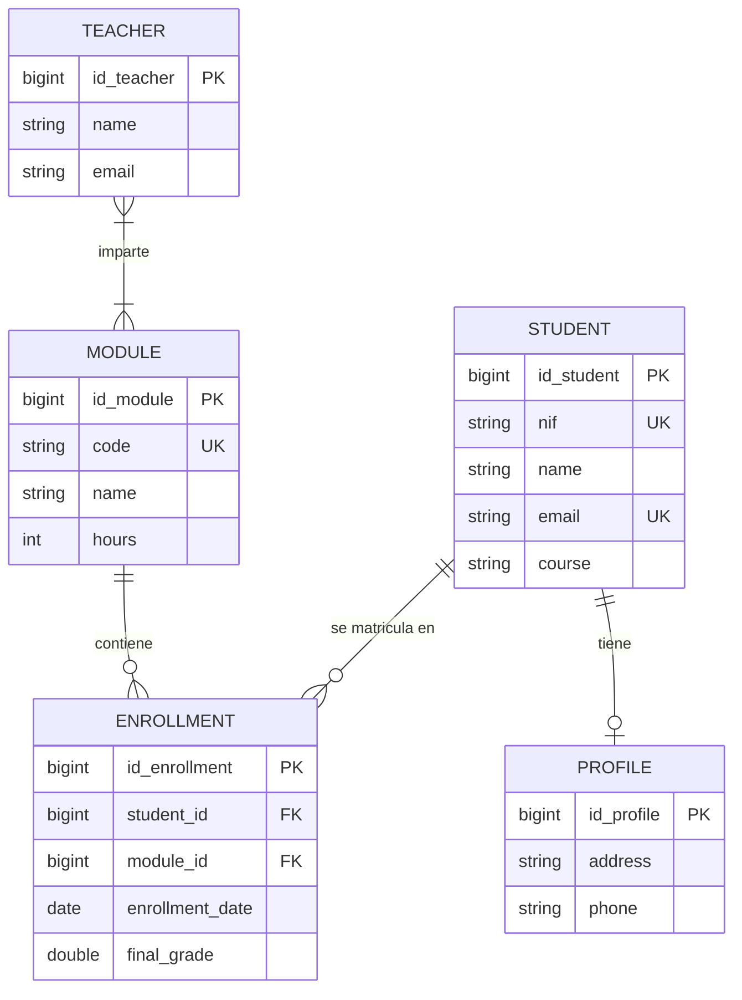
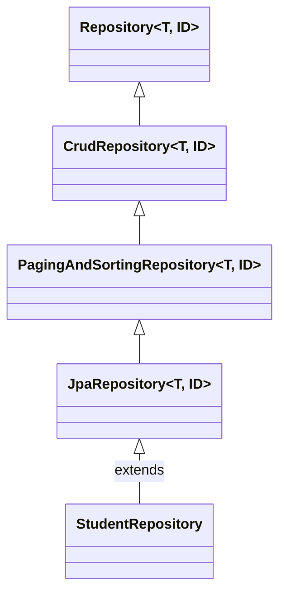
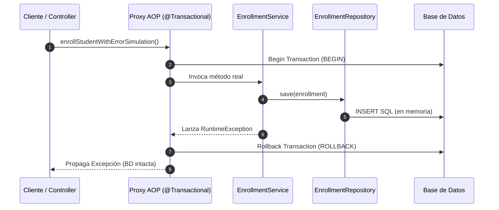
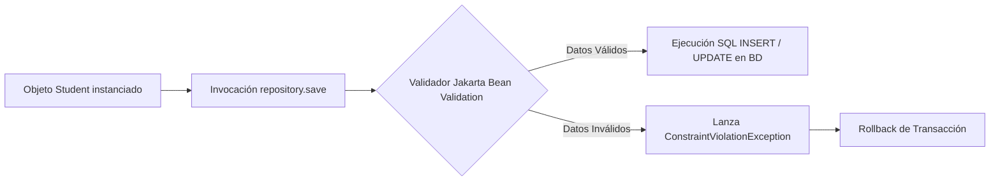
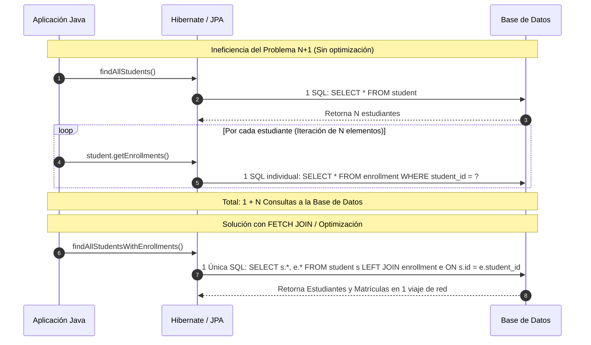

# UD03. Herramientas de Mapeo Objeto-Relacional (ORM): JPA, Hibernate y Spring Data JPA

## 1. Introducción a JPA y Evolución de la Persistencia

El acceso a datos en aplicaciones empresariales Java ha experimentado una evolución trascendental. Tradicionalmente, la interacción con Sistemas Gestores de Bases de Datos Relacionales (SGBD) se basaba de forma exclusiva en la API **JDBC (Java Database Connectivity)**. Si bien JDBC proporciona un control directo y de bajo nivel sobre la ejecución de sentencias SQL, presenta inconvenientes estructurales severos en proyectos de complejidad media o alta:

1. **Código repetitivo y propenso a errores (Boilerplate Code):** Se requiere escribir y mantener bloques de código extensos para abrir y cerrar conexiones, instanciar objetos `PreparedStatement`, gestionar iteraciones sobre conjuntos de resultados (`ResultSet`) y capturar manualmente excepciones del tipo `SQLException`.
2. **Transformación manual de datos:** Es necesario extraer cada columna del `ResultSet` e instanciar manualmente el objeto Java equivalente mediante constructores o *setters*.
3. **Acoplamiento al motor de base de datos:** Las sentencias SQL quedan embebidas dentro de las clases de código fuente Java, lo que dificulta el mantenimiento, invalida la independencia respecto al dialecto del SGBD y dispersa la lógica de acceso a datos por la aplicación.

Para resolver estas limitaciones, las arquitecturas modernas abstraen la capa de persistencia automatizando el mapeo entre el modelo relacional de la base de datos (tablas, filas y columnas) y el modelo orientado a objetos del lenguaje de programación (clases, instancias y atributos).

---

### 1.1 ¿Qué es JPA?

**JPA (Java Persistence API / Jakarta Persistence)** no es un marco de trabajo (*framework*) ni una biblioteca ejecutable en sí misma, sino una **especificación estándar de Java** que define un conjunto de reglas, anotaciones e interfaces para gestionar la persistencia de objetos Java en bases de datos relacionales.

El propósito fundamental de JPA es permitir que el desarrollador interactúe con el sistema a través de **entidades de dominio** (clases orientadas a objetos) en lugar de manipular sentencias SQL manuales. JPA actúa como una capa de abstracción de alto nivel construida sobre JDBC. En lugar de sustituir a JDBC, JPA lo utiliza internamente para comunicarse con la base de datos a través del driver correspondiente, delegando la generación física de las consultas SQL en un **proveedor de persistencia**.



Un ejemplo comparativo resalta la diferencia de productividad. Mientras que en JDBC insertar un registro requiere definir la cadena SQL, sustituir parámetros posicionales y ejecutar la actualización:

```java
// Enfoque manual con JDBC
String sql = "INSERT INTO student (name, email) VALUES (?, ?)";
try (PreparedStatement ps = connection.prepareStatement(sql)) {
    ps.setString(1, "Ana");
    ps.setString(2, "ana@example.com");
    ps.executeUpdate();
}
```

Con JPA y su abstracción de repositorio, la operación se reduce a instanciar el objeto de dominio y llamar al método de persistencia:

```java
// Enfoque declarativo con JPA
Student student = new Student("Ana", "ana@example.com");
studentRepository.save(student);
```

---

### 1.2 El Papel de Hibernate como Proveedor de Persistencia

**Hibernate** es la implementación de la especificación JPA más extendida en la industria. Funciona como el motor intermediario que traduce las operaciones realizadas sobre objetos Java a sentencias SQL entendibles por el SGBD subyacente, y viceversa.

Además de cumplir rigurosamente la especificación JPA, Hibernate aporta capacidades avanzadas de infraestructura:

- **Gestión de Caché de Primer y Segundo Nivel:** Optimiza las lecturas en memoria reduciendo accesos innecesarios al almacenamiento físico.
- **Consultas Orientadas a Objetos (HQL / JPQL):** Permite realizar búsquedas sobre entidades y sus atributos en lugar de sobre tablas y columnas físicas.
- **Gestión Transparente del Ciclo de Vida de Entidades:** Controla de forma automática los estados de los objetos (transitorio, persistente, separado/detached y eliminado).
- **Herramientas Integradas de Auditoría y Validación:** Facilita la verificación de reglas de integridad de datos antes de enviar las instrucciones DML a la base de datos.

En el ecosistema de Spring Boot, el paquete `spring-boot-starter-data-jpa` incluye Hibernate como el proveedor de persistencia por defecto, configurándolo de forma transparente para el desarrollador.

---

### 1.3 Ventajas Comparativas: JDBC Tradicional vs. JPA / Hibernate

| Criterio / Aspecto | JDBC Tradicional (Puro) | JPA / Hibernate (ORM) |
| :--- | :--- | :--- |
| **Mapeo de Datos** | Manual mediante iteración explícita sobre `ResultSet` | Automático a través de anotaciones en clases de entidad |
| **Generación de SQL** | Escrito de forma manual por el desarrollador | Generado automáticamente por el proveedor de persistencia |
| **Gestión Transaccional** | Control manual (`setAutoCommit(false)`, `commit()`, `rollback()`) | Declarativo mediante la anotación `@Transactional` |
| **Portabilidad de la BD** | Elevada dependencia del dialecto SQL específico del motor | Total independencia del SGBD mediante abstracción de dialecto |
| **Mantenimiento y Legibilidad** | Mantenimiento complejo debido a la dispersión de SQL | Código limpio, modular y centrado en la lógica de negocio |
| **Productividad** | Productividad media o baja debido al código repetitivo | Productividad elevada con mínimos componentes boilerplate |

---

### 1.4 Arquitectura General y Componentes del Ecosistema

El ecosistema de persistencia basado en JPA está estructurado en torno a cinco componentes clave:

1. **Entidades (*Entities*):** Clases Java anotadas que representan tablas de la base de datos relacional.
2. **EntityManager:** Interfaz primaria del entorno JPA encargada de gestionar el ciclo de vida de las entidades y ejecutar operaciones de persistencia (guardar, buscar, eliminar y sincronizar).
3. **Unidad de Persistencia (*Persistence Unit*):** Conjunto de clases de entidad gestionadas bajo un mismo esquema de configuración de base de datos.
4. **Proveedor de Persistencia (*Persistence Provider*):** Implementación concreta de la especificación (por ejemplo, Hibernate).
5. **Contexto de Persistencia (*Persistence Context*):** Área de memoria donde el `EntityManager` mantiene y rastrea el estado de los objetos persistentes durante una transacción.

Spring Boot simplifica esta arquitectura al autoconfigurar la fábrica de gestores de entidades (`EntityManagerFactory`), la gestión de transacciones y el escaneo de entidades, permitiendo al desarrollador interactuar directamente mediante interfaces de repositorio.

---

### 1.5 Limitaciones y Consideraciones Técnicas

A pesar de las ventajas en productividad, el uso de herramientas ORM exige un conocimiento sólido del comportamiento subyacente de la base de datos relacional:

- **Necesidad de comprender el SQL generado:** El desarrollador debe inspeccionar y entender las consultas que Hibernate ejecuta internamente para evitar cuellos de botella.
- **Riesgo de Ineficiencias de Rendimiento:** Un mal diseño de relaciones o de estrategias de carga puede desencadenar problemas graves, como el conocido **problema N+1**.
- **JPA no sustituye al SGBD:** JPA es una capa intermedia de abstracción. La integridad referencial, el diseño de índices, las restricciones físicas y la optimización de almacenamiento siguen siendo responsabilidad del diseño de la base de datos.

---

### 1.6 Perspectiva de Arquitectura Comparada: El Ecosistema ORM en Python vs. Java

Para obtener una visión global de la ingeniería de software, es imprescindible comprender cómo otros lenguajes de alto nivel como **Python** resuelven la capa de persistencia:

1. **Inexistencia de una especificación oficial previa en Python:**
   A diferencia de Java, donde existe la norma oficial **JPA / Jakarta Persistence** promovida por la industria (Sun/Oracle/Eclipse Foundation), en Python **no existe un estándar formal equivalente a JPA**. En su lugar, Python define la especificación **PEP 249 (Python Database API Specification v2.0)**, que equivale conceptualmente a **JDBC** (define cómo interactúan los drivers de bajo nivel con la base de datos), dejando la capa ORM al criterio de bibliotecas de terceros.

2. **Patrones de Diseño de Persistencia: Data Mapper vs. Active Record**
   - **Java (JPA/Hibernate) - Data Mapper:** Separa estrictamente la representación de datos (POJO) de la lógica de persistencia (`EntityManager`). La clase `Student` no sabe cómo guardarse a sí misma; requiere un componente externo.
   - **Python (SQLAlchemy) - Data Mapper:** SQLAlchemy sigue exactamente el mismo patrón que JPA/Hibernate. Utiliza una `Session` (equivalente al `EntityManager`) para rastrear cambios en objetos simples.
   - **Python (Django ORM) - Active Record:** Django ORM utiliza el patrón *Active Record*. Cada clase de modelo hereda de `models.Model`, por lo que el propio objeto contiene la lógica de persistencia y se guarda directamente invocando `estudiante.save()`.

| Dimensión de Análisis | Java (JPA / Hibernate) | Python (SQLAlchemy) | Python (Django ORM) |
| :--- | :--- | :--- | :--- |
| **Estándar de Lenguaje** | JPA / Jakarta Persistence (JSR) | Sin especificación formal (Librería popular) | Sin especificación formal (Incluido en Django) |
| **Patrón Arquitectónico** | **Data Mapper** (`EntityManager`) | **Data Mapper** (`Session`) | **Active Record** (`Model.save()`) |
| **Equivalente a Driver** | Driver JDBC (e.g., PostgreSQL JDBC) | Driver DB-API (e.g., `psycopg2`, `asyncpg`) | Driver DB-API (`psycopg2`) |
| **Control de Persistencia** | Contexto de Persistencia externo | `Session` externa | Integrado dentro del propio modelo |

---

## 2. Arquitectura de JPA y Configuración de la Infraestructura

### 2.1 Los Cuatro Pilares de la Persistencia en JPA

La arquitectura interna de JPA se sostiene en cuatro componentes esenciales que operan coordinadamente para abstraer la base de datos relacional:

1. **Las Entidades:** Objetos de dominio cuyos estados deben almacenarse de forma permanente.
2. **El EntityManager:** Administrador encargado de instanciar, buscar, actualizar y eliminar entidades dentro del contexto de persistencia.
3. **El Proveedor de Persistencia (Hibernate):** Encargado de traducir las llamadas del `EntityManager` a sentencias SQL concretas compatibles con el motor relacional.
4. **El Contexto de Persistencia:** Entorno de memoria intermedia que actúa como una "caché de primer nivel" donde las entidades están identificadas unívocamente por su clave primaria y sus cambios son rastreados dinámicamente.

---

### 2.2 El Contexto de Persistencia y Ciclo de Vida

El contexto de persistencia gestiona los objetos Java a lo largo de un ciclo de vida compuesto por cuatro estados definidos:

- **Transitorio (*Transient*):** El objeto ha sido creado con la palabra clave `new`, pero no está asociado a ningún contexto de persistencia ni posee una clave primaria en la base de datos.
- **Persistente (*Managed / Persistent*):** El objeto está asociado a un contexto de persistencia activo y posee una identidad en la base de datos. Cualquier modificación en sus atributos será detectada automáticamente (*dirty checking*) y sincronizada con la base de datos al finalizar la transacción.
- **Separado (*Detached*):** El objeto estuvo gestionado, posee clave primaria, pero su contexto de persistencia se ha cerrado o borrado. Los cambios realizados sobre él no se reflejan automáticamente en la base de datos.
- **Eliminado (*Removed*):** El objeto está marcado para ser borrado de la base de datos al confirmarse la transacción.



#### Comparativa de Gestión de Contexto: JPA `EntityManager` vs. Python SQLAlchemy `Session`

El concepto de *Contexto de Persistencia* con seguimiento de cambios (*dirty checking*) en Java es idéntico a la `Session` en SQLAlchemy (Python):

```python
# En Python (SQLAlchemy - Patrón Data Mapper idéntico a JPA)
from sqlalchemy.orm import Session

with Session(engine) as session:
    # Estado Transient
    nuevo_alumno = Student(name="Ana", email="ana@ejemplo.com")
    
    # Pasa a Managed (Persistent)
    session.add(nuevo_alumno)
    
    # Dirty checking automático: al modificar el atributo, la sesión detecta el cambio
    nuevo_alumno.email = "ana.gomez@ejemplo.com"
    
    # Sincronización física con la base de datos (Commit SQL)
    session.commit()
```

---

### 2.3 Integración con Spring Boot, HikariCP y Pooling de Conexiones

En aplicaciones empresariales, abrir y cerrar una conexión TCP con la base de datos por cada petición de usuario resulta inaceptable por el elevado coste de latencia y procesamiento. Por ello, se utilizan **pools de conexiones**.

Spring Boot autoconfigura por defecto **HikariCP**, considerado el administrador de pool de conexiones JDBC más rápido, ligero y eficiente del ecosistema Java. HikariCP mantiene un conjunto precalculado de conexiones abiertas que son reutilizadas por los hilos de la aplicación.

La configuración recomendada en el archivo `application.yml` integra la fuente de datos, el pool HikariCP y el comportamiento de Hibernate:

```yaml
spring:
  datasource:
    url: jdbc:postgresql://localhost:5432/aad_db
    username: postgres
    password: 1234
    driver-class-name: org.postgresql.Driver
    hikari:
      maximum-pool-size: 10
      minimum-idle: 2
      idle-timeout: 60000
      pool-name: AcademicHikariPool

  jpa:
    hibernate:
      ddl-auto: create-drop
    show-sql: true
    properties:
      hibernate:
        format_sql: true
```

---

### 2.4 Fundamentos del Mapeo Objeto-Relacional (ORM)

El **Mapeo Objeto-Relacional (ORM)** es la técnica de programación que establece la correspondencia formal entre el paradigma orientado a objetos y el modelo relacional:

- **Clase Java** $\rightarrow$ **Tabla de Base de Datos**
- **Atributo / Campo** $\rightarrow$ **Columna de la Tabla**
- **Instancia / Objeto** $\rightarrow$ **Fila / Registro**
- **Relación entre Objetos** $\rightarrow$ **Clave Foránea (*Foreign Key*) o Tabla Intermedia**



---

### 2.5 Flujo de Trabajo Comparativo: JDBC vs. Spring Data JPA

| Fase del Flujo | Modelo JDBC / JdbcTemplate | Modelo JPA / Spring Data JPA |
| :--- | :--- | :--- |
| **Conexión** | Apertura/cierre manual por operación | Obtención y devolución automática desde HikariCP |
| **Construcción SQL** | Sentencia concatenada o parametrizada explícita | Generación dinámica por Hibernate según metadatos de entidad |
| **Mapeo de Datos** | Extracción manual iterativa mediante `RowMapper` | Transformación automática por anotaciones JPA |
| **Gestión de Transacciones** | Control manual de `Connection` (`commit`/`rollback`) | Control declarativo por proxy AOP mediante `@Transactional` |
| **Cierre de Recursos** | Bloque `try-with-resources` explícito sobre conex./statements | Liberación automatizada por el contenedor de Spring |

---

## 3. Entidades y Mapeo Objeto-Relacional Avanzado

### 3.1 Creación y Gestión Automática del Esquema DDL (`ddl-auto`)

Hibernate permite gestionar el ciclo de vida de la estructura DDL de la base de datos a partir de las anotaciones presentes en las clases de entidad. El parámetro `spring.jpa.hibernate.ddl-auto` acepta las siguientes opciones estratégicas:

| Opción `ddl-auto` | Descripción del Comportamiento | Entorno de Aplicación Recomendado |
| :--- | :--- | :--- |
| **`none`** | No ejecuta ninguna acción DDL sobre la base de datos. | **Entornos de Producción** (el esquema se gestiona con Flyway/Liquibase). |
| **`validate`** | Verifica que las tablas y columnas existentes coincidan exactamente con las entidades. Si hay discrepancias, detiene el arranque. | **Entornos de Pre-producción / Staging**. |
| **`update`** | Actualiza la estructura de la base de datos añadiendo nuevas tablas o columnas sin borrar datos ni columnas existentes. | **Entornos de Desarrollo Local** dinámicos. |
| **`create`** | Elimina las tablas existentes y las crea nuevamente desde cero al arrancar la aplicación. | **Pruebas de Integración** aisladas. |
| **`create-drop`** | Crea el esquema al iniciar la aplicación y lo destruye completamente al detener el contexto de Spring. | **Entornos Educativos, Docencia y Pruebas Unitarias**. |

---

### 3.2 Definición de Entidades con Anotaciones JPA

Una clase de entidad es un POJO Java anotado que cumple las siguientes reglas estructurales:

1. Debe estar decorada con la anotación `@Entity`.
2. Opcionalmente, especifica el nombre de la tabla mediante `@Table`.
3. Debe poseer un atributo marcado con `@Id` como clave primaria.
4. Requiere un **constructor sin argumentos (vacío)** de visibilidad `public` o `protected` exigido por la especificación para la instanciación por reflexión.

```java
package com.edu.aad.model;

import jakarta.persistence.*;
import lombok.Getter;
import lombok.NoArgsConstructor;
import lombok.Setter;

@Entity
@Table(name = "student")
@Getter
@Setter
@NoArgsConstructor
public class Student {

    @Id
    @GeneratedValue(strategy = GenerationType.IDENTITY)
    @Column(name = "id_student")
    private Long id;

    @Column(name = "nif", nullable = false, unique = true, length = 9)
    private String nif;

    @Column(name = "name", nullable = false, length = 100)
    private String name;

    @Column(name = "email", nullable = false, unique = true, length = 100)
    private String email;

    @Column(name = "course", nullable = false, length = 50)
    private String course;

    public Student(String nif, String name, String email, String course) {
        this.nif = nif;
        this.name = name;
        this.email = email;
        this.course = course;
    }
}
```

---

### 3.3 Estrategias de Generación de Claves Primarias (`@GeneratedValue`)

La anotación `@GeneratedValue` especifica cómo se asignan los valores de las claves primarias:

- **`GenerationType.IDENTITY`:** Delega la generación en columnas autoincrementales nativas del SGBD (`SERIAL` o `BIGSERIAL` en PostgreSQL, `AUTO_INCREMENT` en MySQL).
- **`GenerationType.SEQUENCE`:** Utiliza una secuencia propia del motor de base de datos (`CREATE SEQUENCE`). Es la estrategia más eficiente para inserciones por lotes (*batching*).
- **`GenerationType.AUTO`:** Deja que Hibernate seleccione automáticamente la estrategia adecuada según el dialecto del SGBD configurado.
- **`GenerationType.TABLE`:** Utiliza una tabla auxiliar en la base de datos para simular una secuencia. Incurre en un impacto negativo en el rendimiento por bloqueos de tabla.

---

### 3.4 Modelado de Relaciones entre Entidades en el Dominio Académico



#### 3.4.1 Relación Uno a Uno (`@OneToOne`)

Ocurre cuando un registro de una entidad se asocia exclusivamente con un registro de otra entidad. Por ejemplo, cada estudiante posee un único perfil personal (`Profile`):

```java
@Entity
@Table(name = "profile")
@Getter @Setter @NoArgsConstructor
public class Profile {

    @Id
    @GeneratedValue(strategy = GenerationType.IDENTITY)
    private Long id;

    private String address;
    private String phone;
}

@Entity
@Table(name = "student")
@Getter @Setter @NoArgsConstructor
public class Student {

    @Id
    @GeneratedValue(strategy = GenerationType.IDENTITY)
    private Long id;

    private String name;

    @OneToOne(cascade = CascadeType.ALL)
    @JoinColumn(name = "profile_id", referencedColumnName = "id")
    private Profile profile;
}
```

#### 3.4.2 Relaciones Uno a Muchos y Muchos a Uno (`@OneToMany` / `@ManyToOne`)

Es la relación más habitual. En el dominio académico, un estudiante posee múltiples matrículas (`Enrollment`), pero cada matrícula pertenece a un único estudiante:

```java
@Entity
@Table(name = "student")
@Getter @Setter @NoArgsConstructor
public class Student {

    @Id
    @GeneratedValue(strategy = GenerationType.IDENTITY)
    private Long id;

    private String name;

    @OneToMany(mappedBy = "student", cascade = CascadeType.ALL, orphanRemoval = true)
    private List<Enrollment> enrollments = new ArrayList<>();
}

@Entity
@Table(name = "enrollment")
@Getter @Setter @NoArgsConstructor
public class Enrollment {

    @Id
    @GeneratedValue(strategy = GenerationType.IDENTITY)
    private Long id;

    @ManyToOne(fetch = FetchType.LAZY)
    @JoinColumn(name = "student_id", nullable = false)
    private Student student;

    @ManyToOne(fetch = FetchType.LAZY)
    @JoinColumn(name = "module_id", nullable = false)
    private Module module;

    private LocalDate enrollmentDate;
    private Double finalGrade;
}
```

#### 3.4.3 Relaciones Muchos a Muchos (`@ManyToMany`) y la Entidad Intermedia `Enrollment`

Cuando dos entidades se relacionan de forma múltiple (por ejemplo, `Teacher` e imparte múltiples `Module`, y un `Module` es impartido por múltiples `Teacher`), se utiliza `@ManyToMany` con `@JoinTable`:

```java
@Entity
@Table(name = "teacher")
@Getter @Setter @NoArgsConstructor
public class Teacher {

    @Id
    @GeneratedValue(strategy = GenerationType.IDENTITY)
    private Long id;

    private String name;

    @ManyToMany
    @JoinTable(
        name = "teacher_module",
        joinColumns = @JoinColumn(name = "teacher_id"),
        inverseJoinColumns = @JoinColumn(name = "module_id")
    )
    private List<Module> modules = new ArrayList<>();
}
```

*Nota del Dominio Académico:* En la relación entre `Student` y `Module` no se utiliza directamente `@ManyToMany`, porque la unión física (la matrícula) contiene atributos propios requeridos por el negocio (`enrollmentDate` y `finalGrade`). En su lugar, se descompone en dos relaciones `@ManyToOne` dentro de la entidad intermedia explicitada `Enrollment`.

---

### 3.5 Comparativa de Código: Definición de Entidades y Relaciones (Java JPA vs. Python)

Para ilustrar la coincidencia de conceptos de modelado entre lenguajes, la siguiente tabla muestra la misma entidad `Student` y su relación `@OneToMany` con `Enrollment`:

```java
// JAVA (JPA / Hibernate)
@Entity
@Table(name = "student")
public class Student {
    @Id
    @GeneratedValue(strategy = GenerationType.IDENTITY)
    private Long id;

    @Column(nullable = false, unique = true)
    private String email;

    @OneToMany(mappedBy = "student", cascade = CascadeType.ALL)
    private List<Enrollment> enrollments = new ArrayList<>();
}
```

```python
# PYTHON (SQLAlchemy 2.0 - Declarativo)
from sqlalchemy import String, ForeignKey
from sqlalchemy.orm import DeclarativeBase, Mapped, mapped_column, relationship

class Base(DeclarativeBase):
    pass

class Student(Base):
    __tablename__ = "student"
    
    id: Mapped[int] = mapped_column(primary_key=True)
    email: Mapped[str] = mapped_column(String(100), nullable=False, unique=True)
    
    # Equivalente a @OneToMany(mappedBy="student")
    enrollments: Mapped[list["Enrollment"]] = relationship(back_populates="student")
```

```python
# PYTHON (Django ORM - Active Record)
from django.db import models

class Student(models.Model):
    # Django crea el ID autoincremental automáticamente
    email = models.EmailField(max_length=100, unique=True)
    # Las relaciones inversas @OneToMany se crean automáticamente con el nombre 'enrollment_set'
```

---

### 3.6 Resumen de Correspondencias y Buenas Prácticas de Mapeo

| Tipo de Relación | Cardinalidad Académica | Representación en Base de Datos |
| :--- | :--- | :--- |
| **Uno a Uno (`@OneToOne`)** | Estudiante $\leftrightarrow$ Perfil | Columna con FK `profile_id` en la tabla `student` |
| **Uno a Muchos (`@OneToMany`)** | Estudiante $\rightarrow$ Matrículas | La FK reside en el extremo hijo (`student_id` en `enrollment`) |
| **Muchos a Uno (`@ManyToOne`)** | Matrícula $\rightarrow$ Módulo | Columna con FK `module_id` en la tabla `enrollment` |
| **Muchos a Muchos (`@ManyToMany`)** | Profesor $\leftrightarrow$ Módulo | Tabla de unión intermedia `teacher_module` (`teacher_id`, `module_id`) |

**Buenas Prácticas Obligatorias:**
- Utilizar siempre tipos envoltorio Java (`Long`, `Integer`, `Double`) en lugar de primitivos para permitir valores nulos en columnas opcionales.
- Excluir los campos de relación bidireccional en los métodos `toString()`, `equals()` y `hashCode()` para evitar bucles de recursión infinita (`StackOverflowError`).
- Configurar `FetchType.LAZY` en todas las relaciones `@ManyToOne` y `@OneToOne` para optimizar el rendimiento de lectura.

---

## 4. Repositorios JPA y Acceso Declarativo a Datos

### 4.1 Concepto e Infraestructura de `JpaRepository`

En Spring Data JPA, un **repositorio** es una interfaz declarativa que centraliza las operaciones de acceso a datos sobre una entidad específica. Para construir un repositorio, basta con definir una interfaz que extienda `JpaRepository<Entidad, TipoId>`:



Durante la fase de arranque de la aplicación, Spring Data JPA analiza estas interfaces y utiliza proxies dinámicos para generar la implementación concreta en tiempo de ejecución, eliminando la necesidad de escribir la capa DAO manualmente.

---

### 4.2 De `JdbcTemplate` a `JpaRepository`: Simplificación del Código

| Operación | Implementación Manual con `JdbcTemplate` | Implementación Declarativa con `JpaRepository` |
| :--- | :--- | :--- |
| **Buscar por ID** | Consulta SQL explícita + Mapeo manual de `ResultSet` | `studentRepository.findById(id)` |
| **Obtener Todos** | `SELECT * FROM student` + Iteración sobre filas | `studentRepository.findAll()` |
| **Guardar / Actualizar** | `INSERT INTO ...` o `UPDATE ...` con parámetros `?` | `studentRepository.save(student)` |
| **Eliminar** | `DELETE FROM student WHERE id = ?` | `studentRepository.deleteById(id)` |
| **Contar Filas** | `SELECT COUNT(*) FROM student` | `studentRepository.count()` |

---

### 4.3 Operaciones CRUD Fundamentales y Métodos Estándar

`JpaRepository` proporciona más de veinte métodos listos para usar:

- **`S save(S entity)`:** Inserta el registro si el ID es nulo, o ejecuta un `UPDATE` si el objeto ya posee clave primaria y existe en el contexto.
- **`Optional<T> findById(ID id)`:** Busca un registro por su clave primaria devolviendo un contenedor `Optional` para evitar `NullPointerException`.
- **`List<T> findAll()`:** Recupera todas las entidades de la tabla correspondiente.
- **`void deleteById(ID id)`:** Elimina el registro por su identificador único.
- **`boolean existsById(ID id)`:** Verifica la presencia de una entidad sin cargar todo el objeto en memoria.

---

### 4.4 Consultas Derivadas (*Query Methods*)

Spring Data JPA permite declarar consultas personalizadas interpretando la nomenclatura del método de la interfaz. La firma del método debe seguir la convención `findBy...`, `readBy...` o `countBy...`:

```java
@Repository
public interface StudentRepository extends JpaRepository<Student, Long> {

    // SELECT * FROM student WHERE name = ?
    List<Student> findByName(String name);

    // SELECT * FROM student WHERE email LIKE '%gmail%'
    List<Student> findByEmailContaining(String domain);

    // SELECT * FROM student WHERE course = ? ORDER BY name ASC
    List<Student> findByCourseOrderByNameAsc(String course);
}
```

Palabras clave soportadas en consultas derivadas: `And`, `Or`, `Between`, `LessThan`, `GreaterThan`, `StartingWith`, `EndingWith`, `Containing`, `IgnoreCase`, `OrderBy`.

---

### 4.5 Navegación por Relaciones en Consultas Derivadas

Es posible consultar entidades hijas a través de los atributos de sus entidades asociadas. En `EnrollmentRepository`, podemos buscar matrículas por el ID del estudiante o por el código del módulo:

```java
@Repository
public interface EnrollmentRepository extends JpaRepository<Enrollment, Long> {

    // Genera automáticamente un JOIN entre enrollment y student
    List<Enrollment> findByStudentId(Long studentId);

    // Genera un JOIN entre enrollment y module buscando por el código del módulo
    List<Enrollment> findByModuleCode(String code);
}
```

---

### 4.6 Inyección de Dependencias en Servicios con Lombok (`@RequiredArgsConstructor`)

La buena práctica en Spring moderno prescribe la **inyección por constructor** con atributos `final`. Mediante la anotación `@RequiredArgsConstructor` de Lombok, se elimina el código repetitivo de los constructores:

```java
package com.edu.aad.service;

import com.edu.aad.model.Student;
import com.edu.aad.repository.StudentRepository;
import lombok.RequiredArgsConstructor;
import org.springframework.stereotype.Service;

import java.util.List;

@Service
@RequiredArgsConstructor
public class StudentService {

    private final StudentRepository studentRepository;

    public List<Student> getAllStudents() {
        return studentRepository.findAll();
    }

    public Student createStudent(Student student) {
        return studentRepository.save(student);
    }
}
```

---

## 5. Gestión de la Persistencia y Transacciones Declarativas

### 5.1 Concepto de Transacción y Mantenimiento de la Coherencia

Una **transacción** es un conjunto de operaciones de lectura y escritura que se ejecutan como una única unidad atómica de trabajo. Garantiza las propiedades **ACID** (Atomicidad, Consistencia, Aislamiento y Durabilidad).

En JPA, cuando se invocan métodos que modifican el estado de la base de datos dentro de un bloque transaccional, todas las operaciones se confirman conjuntamente (`commit`) o se cancelan en su totalidad (`rollback`) si ocurre una excepción runtime.

---

### 5.2 Uso Práctico de `@Transactional` en la Capa de Servicio

La anotación `@Transactional` de Spring indica que la ejecución del método debe ser envuelta por un proxy transaccional. Al ingresar al método se inicia la transacción; al salir con éxito se ejecuta el `commit`, y si se lanza una excepción no controlada (`RuntimeException`), se ejecuta automáticamente el `rollback`.



```java
package com.edu.aad.service;

import com.edu.aad.model.Enrollment;
import com.edu.aad.model.Module;
import com.edu.aad.model.Student;
import com.edu.aad.repository.EnrollmentRepository;
import com.edu.aad.repository.ModuleRepository;
import com.edu.aad.repository.StudentRepository;
import lombok.RequiredArgsConstructor;
import org.springframework.stereotype.Service;
import org.springframework.transaction.annotation.Transactional;

import java.time.LocalDate;

@Service
@RequiredArgsConstructor
public class EnrollmentService {

    private final StudentRepository studentRepository;
    private final ModuleRepository moduleRepository;
    private final EnrollmentRepository enrollmentRepository;

    @Transactional
    public void enrollStudentWithErrorSimulation(Long studentId, Long moduleId) {
        Student student = studentRepository.findById(studentId)
                .orElseThrow(() -> new RuntimeException("Estudiante no encontrado"));

        Module module = moduleRepository.findById(moduleId)
                .orElseThrow(() -> new RuntimeException("Módulo no encontrado"));

        Enrollment enrollment = new Enrollment();
        enrollment.setStudent(student);
        enrollment.setModule(module);
        enrollment.setEnrollmentDate(LocalDate.now());

        enrollmentRepository.save(enrollment);

        // Simulación intencionada de fallo de negocio
        if (true) {
            throw new RuntimeException("Error simulado: revirtiendo transacción de matrícula");
        }
    }
}
```

*Comportamiento observado:* Aunque `enrollmentRepository.save(enrollment)` fue ejecutado en memoria, el lanzamiento posterior de la excepción provoca el `rollback` automático por parte de Spring, garantizando que ninguna fila huérfana sea insertada físicamente en la tabla `enrollment`.

---

### 5.3 Control de Rollback y Transacciones de Solo Lectura (`readOnly = true`)

Para operaciones de consulta que no modifican datos, es una buena práctica marcar la transacción como de solo lectura:

```java
@Transactional(readOnly = true)
public List<Enrollment> getAllEnrollments() {
    return enrollmentRepository.findAll();
}
```

`@Transactional(readOnly = true)` informa al proveedor de persistencia (Hibernate) de que no es necesario realizar la comprobación de modificaciones (*dirty checking*) ni mantener bloqueos de escritura, lo que reduce drásticamente el consumo de memoria y mejora el rendimiento de lectura.

---

### 5.4 Comparativa Arquitectónica: Gestores de Transacciones (Spring vs. Python)

Mientras que Spring logra la gestión transaccional de forma declarativa y transparente mediante **AOP Proxies** (Orientación a Aspectos), en Python las transacciones se gestionan de forma explícita mediante **Gestores de Contexto (`with`)** o decoradores específicos:

```java
// JAVA (Spring Boot - Proxy AOP Declarativo)
@Service
public class EnrollmentService {
    @Transactional
    public void matricular() {
        // Toda la ejecución del método queda envuelta en BEGIN / COMMIT / ROLLBACK automático
    }
}
```

```python
# PYTHON (Django - Decorador o Context Manager)
from django.db import transaction

@transaction.atomic # Enuelve la función en un bloque transaccional ACID
def matricular_estudiante():
    # Si ocurre una excepción dentro, Django ejecuta un ROLLBACK
    pass

# O mediante Gestor de Contexto explicito:
def matricular_con_contexto():
    with transaction.atomic():
        # Operaciones DML
        pass
```

```python
# PYTHON (SQLAlchemy - Gestor de Contexto con Session)
with Session(engine) as session:
    with session.begin(): # Inicia transacción explícita
        session.add(nueva_matricula)
        # Al salir del bloque con éxito ejecuta commit(); si falla, rollback()
```

---

### 5.5 Buenas Prácticas Transaccionales

1. Ubicar la anotación `@Transactional` exclusivamente en la **capa de servicio (`@Service`)**, nunca en controladores REST ni en la capa de persistencia.
2. Asegurar que las llamadas a métodos `@Transactional` se realicen desde clases externas para garantizar que sean interceptadas por el proxy AOP de Spring.
3. Utilizar `readOnly = true` en métodos puramente de consulta.

---

## 6. Consultas Personalizadas con `@Query` y JPQL

### 6.1 Sintaxis y Naturaleza de JPQL (Java Persistence Query Language)

Cuando las consultas derivadas por nombre resultan insuficientes para expresar condiciones complejas, se recurre a **JPQL**.

**JPQL** es un lenguaje de consultas orientado a objetos que mantiene una sintaxis similar a SQL, pero opera sobre **entidades Java y sus atributos** en lugar de tablas y columnas físicas:

- **SQL Tradicional:** `SELECT * FROM alumno WHERE email LIKE '%centro.es'`
- **JPQL Equivalente:** `SELECT s FROM Student s WHERE s.email LIKE '%centro.es'`

---

### 6.2 Consultas Parametrizadas con `@Query` y `@Param`

Mediante la anotación `@Query` sobre un método de repositorio, se especifica la consulta JPQL personalizada. Los parámetros de entrada se vinculan mediante `@Param`:

```java
@Repository
public interface StudentRepository extends JpaRepository<Student, Long> {

    @Query("SELECT s FROM Student s WHERE s.email LIKE %:text%")
    List<Student> searchByEmailDomain(@Param("text") String text);
}
```

---

### 6.3 Consultas Multicriterio, Uniones y Ordenación

JPQL permite filtrar combinando atributos de relaciones y aplicando ordenación:

```java
@Repository
public interface EnrollmentRepository extends JpaRepository<Enrollment, Long> {

    @Query("SELECT e FROM Enrollment e WHERE e.student.name = :studentName AND e.finalGrade >= :minGrade ORDER BY e.finalGrade DESC")
    List<Enrollment> findByStudentAndHighGrades(
            @Param("studentName") String studentName,
            @Param("minGrade") Double minGrade
    );
}
```

---

### 6.4 Cuadro Comparativo: Métodos Derivados vs. `@Query` JPQL

| Característica | Métodos Derivados (`findBy...`) | Consultas Personalizadas con `@Query` |
| :--- | :--- | :--- |
| **Complejidad de Filtro** | Ideal para filtros sencillos sobre 1 o 2 atributos | Recomendado para consultas complejas o uniones compuestas |
| **Legibilidad del Nombre** | Puede volverse excesivamente largo y difícil de leer | El nombre del método Java puede ser corto y descriptivo |
| **Independencia del SGBD** | Totalmente independiente | Totalmente independiente (salvo que se use `nativeQuery = true`) |
| **Curva de Aprendizaje** | Inmediata (sólo convención de nombres) | Requiere dominar la sintaxis y funciones de JPQL |

---

## 7. Validación de Datos y Manejo de Excepciones

### 7.1 Declaración de Reglas de Validación con Jakarta Bean Validation

Para garantizar la calidad de los datos antes de persistirlos, JPA se integra de forma nativa con **Jakarta Bean Validation**. Las reglas se declaran mediante anotaciones sobre los atributos de la entidad:



```java
package com.edu.aad.model;

import jakarta.persistence.*;
import jakarta.validation.constraints.*;
import lombok.Getter;
import lombok.NoArgsConstructor;
import lombok.Setter;

@Entity
@Table(name = "student")
@Getter @Setter @NoArgsConstructor
public class Student {

    @Id
    @GeneratedValue(strategy = GenerationType.IDENTITY)
    private Long id;

    @NotBlank(message = "El NIF es un campo obligatorio")
    @Size(min = 9, max = 9, message = "El NIF debe tener exactamente 9 caracteres")
    private String nif;

    @NotBlank(message = "El nombre no puede estar vacío")
    private String name;

    @NotBlank(message = "El email no puede estar vacío")
    @Email(message = "El formato del email no es válido")
    private String email;

    @NotNull(message = "El curso es obligatorio")
    private String course;
}
```

---

### 7.2 Captura y Manejo de `ConstraintViolationException`

Cuando se intenta guardar o actualizar una entidad que incumple alguna regla de validación, la llamada a `repository.save()` lanza automáticamente una excepción del tipo `ConstraintViolationException`. La transacción se interrumpe inmediatamente y no se ejecuta ninguna instrucción DML en la base de datos.

---

### 7.3 Arquitectura de Excepciones en Servicios y Tipos Personalizados

En lugar de propagar excepciones genéricas, la capa de servicio debe capturar la ausencia de datos y lanzar excepciones de dominio personalizadas:

```java
package com.edu.aad.exception;

public class StudentNotFoundException extends RuntimeException {
    public StudentNotFoundException(String message) {
        super(message);
    }
}
```

Uso dentro del servicio mediante programación funcional con `Optional`:

```java
public Student getStudentById(Long id) {
    return studentRepository.findById(id)
            .orElseThrow(() -> new StudentNotFoundException("Estudiante no encontrado con el ID: " + id));
}
```

---

### 7.4 Integración de Validaciones y Transacciones en el Dominio Académico

En la entidad `Enrollment`, la asociación con `Student` y `Module` debe validarse obligatoriamente mediante `@NotNull` para evitar matrículas huérfanas:

```java
@Entity
@Table(name = "enrollment")
@Getter @Setter @NoArgsConstructor
public class Enrollment {

    @Id
    @GeneratedValue(strategy = GenerationType.IDENTITY)
    private Long id;

    @NotNull(message = "El estudiante es obligatorio")
    @ManyToOne(fetch = FetchType.LAZY)
    @JoinColumn(name = "student_id")
    private Student student;

    @NotNull(message = "El módulo es obligatorio")
    @ManyToOne(fetch = FetchType.LAZY)
    @JoinColumn(name = "module_id")
    private Module module;

    @NotNull(message = "La fecha de matrícula no puede ser nula")
    private LocalDate enrollmentDate;

    @Min(value = 0, message = "La nota mínima es 0")
    @Max(value = 10, message = "La nota máxima es 10")
    private Double finalGrade;
}
```

---

## 8. Gestión de Logs, Inspección y Depuración con Hibernate

### 8.1 Configuración del Nivel de Registro en `application.yml`

Para auditar e inspeccionar las consultas físicas enviadas a la base de datos, se activa el nivel de registro de Hibernate en el archivo de propiedades:

```yaml
spring:
  jpa:
    show-sql: true
    properties:
      hibernate:
        format_sql: true

logging:
  level:
    org.hibernate.SQL: DEBUG
    org.hibernate.type.descriptor.sql.BasicBinder: TRACE
```

---

### 8.2 Análisis e Interpretación del Log de Consultas SQL y Parámetros

Con esta configuración activa, la consola de la aplicación imprime el flujo exacto de ejecución:

```text
2026-10-25 10:15:22.102 DEBUG [main] org.hibernate.SQL : 
    insert 
    into
        student
        (course, email, name, nif) 
    values
        (?, ?, ?, ?)
2026-10-25 10:15:22.105 TRACE [main] org.hibernate.type.descriptor.sql.BasicBinder : binding parameter [1] as [VARCHAR] - [DAM]
2026-10-25 10:15:22.106 TRACE [main] org.hibernate.type.descriptor.sql.BasicBinder : binding parameter [2] as [VARCHAR] - [ana@centro.es]
2026-10-25 10:15:22.106 TRACE [main] org.hibernate.type.descriptor.sql.BasicBinder : binding parameter [3] as [VARCHAR] - [Ana Gómez]
2026-10-25 10:15:22.107 TRACE [main] org.hibernate.type.descriptor.sql.BasicBinder : binding parameter [4] as [VARCHAR] - [12345678A]
```

Esta información permite verificar la coincidencia entre los valores pasados en Java y el binding final realizado por el driver JDBC.

---

### 8.3 Diagnóstico de Problemas de Rendimiento (Efecto N+1) y Buenas Prácticas

El **problema N+1** se produce cuando se recupera una lista de $N$ entidades y, posteriormente, al iterar sobre ellas para acceder a una relación configurada con carga perezosa (`LAZY`), Hibernate ejecuta **una consulta adicional por cada elemento de la lista**, totalizando $N + 1$ consultas a la base de datos.



**Solución mediante Fetch Join en JPQL (Java):**

```java
@Repository
public interface StudentRepository extends JpaRepository<Student, Long> {

    @Query("SELECT DISTINCT s FROM Student s JOIN FETCH s.enrollments")
    List<Student> findAllStudentsWithEnrollments();
}
```

---

### 8.4 Comparativa de Resolución del Problema N+1: Java vs. Python

El efecto N+1 es un problema universal de los ORMs independientemente del lenguaje de programación. Cada tecnología proporciona sus mecanismos para forzar la carga ansiosa (*eager loading*):

| Tecnología / ORM | Mecanismo de Carga Ansiosa (*Eager Loading*) | Ejemplo de Código de Solución |
| :--- | :--- | :--- |
| **Java (JPA / Hibernate)** | `JOIN FETCH` en JPQL o `@EntityGraph` | `@Query("SELECT s FROM Student s JOIN FETCH s.enrollments")` |
| **Python (SQLAlchemy)** | `joinedload()` o `selectinload()` | `session.scalars(select(Student).options(joinedload(Student.enrollments)))` |
| **Python (Django ORM)** | `select_related()` (1:1 / N:1) o `prefetch_related()` (1:N / M:N) | `Student.objects.prefetch_related('enrollment_set').all()` |

---

## 9. Síntesis y Buenas Prácticas para el Desarrollo con Spring Data JPA

1. **Definición de Entidades:**
   - Asegurar siempre un constructor vacío y utilizar tipos de datos objeto (`Long`, `Integer`, `Double`).
   - Evitar referencias circulares en los métodos `toString()`, `equals()` y `hashCode()`.
2. **Uso de Repositorios:**
   - Extender de `JpaRepository` y aprovechar las consultas derivadas para operaciones sencillas.
   - Utilizar `@Query` con JPQL para consultas complejas o que requieran `JOIN FETCH`.
3. **Gestión Transaccional:**
   - Aplicar `@Transactional` obligatoriamente en los métodos de la capa de servicio (`@Service`).
   - Indicar `readOnly = true` en métodos que no modifiquen datos.
4. **Validación e Integridad:**
   - Anotar los atributos de las entidades con Jakarta Bean Validation (`@NotBlank`, `@NotNull`, `@Email`).
   - Lanzar excepciones de dominio personalizadas desde la capa de servicio al no encontrar datos.
5. **Depuración:**
   - Activar los logs de Hibernate (`org.hibernate.SQL: DEBUG`) en entorno de desarrollo local.
